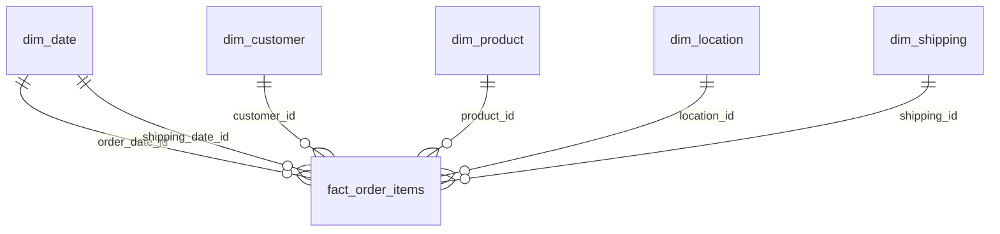

# Project Documentation: Sales & Profitability Analysis

Technical and analytical documentation for the Sales & Profitability Analysis project. The [README](../README.md) is the short tour; this document is the full reference. It covers how the data flows from the source file to the dashboard, what every table and measure means, how to rebuild everything, and what the numbers can and cannot be trusted for.

The DAX measures themselves are in [dax_measures.md](dax_measures.md).

## Table of Contents

1. [Project at a Glance](#1-project-at-a-glance)
2. [Architecture](#2-architecture)
3. [Repository Layout and Run Order](#3-repository-layout-and-run-order)
4. [How to Reproduce](#4-how-to-reproduce)
5. [Data Pipeline in Detail](#5-data-pipeline-in-detail)
6. [Data Dictionary](#6-data-dictionary)
7. [Reporting Views](#7-reporting-views)
8. [Power BI Semantic Model](#8-power-bi-semantic-model)
9. [Metric Definitions and Business Rules](#9-metric-definitions-and-business-rules)
10. [Measures Reference](#10-measures-reference)
11. [Dashboard Guide](#11-dashboard-guide)
12. [Validation and Data Quality](#12-validation-and-data-quality)
13. [Issues Found and Resolved](#13-issues-found-and-resolved)
14. [Results Reference](#14-results-reference)
15. [Assumptions and Limitations](#15-assumptions-and-limitations)
16. [Maintenance and Troubleshooting](#16-maintenance-and-troubleshooting)
17. [Glossary](#17-glossary)

---

## 1. Project at a Glance

| Item | Detail |
|---|---|
| Purpose | Show whether sales growth is turning into profit, what discounting costs, and which products and categories actually earn money |
| Source data | DataCo Smart Supply Chain order-line transactions (see [Source](#source-and-citation)) |
| Grain of the data | One row per order line (one product on one order) |
| Period analysed | 2015, 2016 and 2017 in the report. 2018 holds only 31 days of orders (Jan 1–31) and is excluded from the dashboard |
| Database | PostgreSQL, organised in three layers: `bronze`, `silver`, `gold`, plus a `reports` schema of views |
| BI tool | Power BI Desktop, one `.pbix` file with three report pages |
| Languages | SQL (PostgreSQL dialect) and DAX |
| Deliverables | SQL scripts 01–06, the Power BI report, this documentation, the DAX measure library |

### Source and citation

The data is the *DataCo Smart Supply Chain for Big Data Analysis* dataset (Constante, Silva and Pereira, published on Mendeley Data). Check the licence and attribution requirements on the dataset page before redistributing the CSV. The repository does not include the raw file.

### Three questions the project answers

1. Is the business becoming more profitable, or is it only selling more?
2. Do discounts help the business make money, or do they give away too much margin?
3. Which products and categories drive profit, as opposed to simply volume?

---

## 2. Architecture

### Data flow


| Layer | Schema | Role | Rule |
|---|---|---|---|
| Bronze | `bronze` | Raw copy of the CSV | Nothing is changed. Every column is `TEXT`, so the load cannot fail on a bad value |
| Silver | `silver` | One cleaned, typed table | Same grain as bronze: one row per order line. Trimming, casing and data types are fixed here |
| Gold | `gold` | Star schema for analysis | Dimensions and one fact table with surrogate keys |
| Reports | `reports` | Views for Power BI | Thin, report-shaped selections over gold. No business logic that Power BI cannot see |

### Star schema (gold layer)



`dim_date` is joined to the fact table twice (order date and shipping date). Reports use the order date.

### Why this design

- **Bronze as text** guarantees the raw load always succeeds and keeps an untouched copy for audit.
- **A single silver table** keeps the cleaning logic in one place and makes it easy to compare with bronze row for row.
- **A star schema** keeps filters simple: slicers act on dimensions, measures act on the fact table.
- **Views for the report** mean Power BI never reads gold tables directly, so the gold layer can change without breaking the report as long as the view columns stay the same.

---

## 3. Repository Layout and Run Order

```text
Sales-Profitability-Analysis/
├── sql/
│   ├── 01_bronze_layer.sql          create bronze table (all TEXT) for the CSV load
│   ├── 02_silver_layer.sql          clean and type the data
│   ├── 03_gold_layer.sql            build dimensions and the fact table
│   ├── 04_eda_diagnostics.sql       validation and sanity checks
│   ├── 05_analytical_queries.sql    SQL versions of the key analyses
│   └── 06_reports_views.sql         views consumed by Power BI
├── power bi/
│   ├── Sales-Profitability-Analysis.pbix
│   └── supply_chain_theme.json
├── Docs/
│   ├── documentation.md             this file
│   └── dax_measures.md
├── images/                          dashboard screenshots used in the README
└── README.md
```

**Order of execution**

| Step | Script | When |
|---|---|---|
| 1 | `01_bronze_layer.sql`, then load the CSV | Once, or when the source file changes |
| 2 | `02_silver_layer.sql` | After every bronze load |
| 3 | `03_gold_layer.sql` | After every silver load |
| 4 | `06_reports_views.sql` | After the first gold build, and whenever a view definition changes |
| 5 | `04_eda_diagnostics.sql` | After every rebuild, to validate |
| 6 | `05_analytical_queries.sql` | Any time, for analysis. Read-only |

Scripts 02 and 03 are safe to re-run. Each creates its tables only if they are missing, then empties them with `TRUNCATE` and reloads. The `reports` views are not touched by a normal re-run, because the gold script no longer drops tables.

---

## 4. How to Reproduce

### Prerequisites

- PostgreSQL 9.6 or later. The scripts use `ADD COLUMN IF NOT EXISTS`, `DISTINCT ON`, `FILTER`, `generate_series` over dates and `TRUNCATE ... RESTART IDENTITY`.
- A SQL client such as pgAdmin or `psql`.
- Power BI Desktop (current release).
- The source CSV.

### Steps

1. **Create a database** and run `01_bronze_layer.sql`. It creates `bronze.supplychaindataset` with every column as `TEXT`.
2. **Load the CSV** into that table, using the client's import tool or `\copy`. The source file is not always UTF-8; if the import fails on special characters, set the file encoding to `LATIN1` or `WIN1252`.
3. **Run `02_silver_layer.sql`.** The last statement prints the silver row count, which must equal the bronze row count.
4. **Run `03_gold_layer.sql`.**
5. **Run `06_reports_views.sql`.**
6. **Run `04_eda_diagnostics.sql`** and compare each result with [Section 12](#12-validation-and-data-quality).
7. **Open the `.pbix` file.** Under *Transform data → Data source settings*, point the PostgreSQL source at your server and database, then refresh.
8. **Check the result.** With no slicers applied, the Executive Overview page should show Total Sales $36.45M, Total Profit $3.93M, Profit Margin 10.79%, 63.63K orders, and 18.53K customers.

---

## 5. Data Pipeline in Detail

### 5.1 Bronze

- One table, `bronze."supplychaindataset"`, with the source file's original column headers (mixed case, spaces and brackets, so they must be quoted in SQL).
- All columns are `TEXT`. Nothing is converted, trimmed or removed.

### 5.2 Silver

`02_silver_layer.sql` creates `silver.supplychaindataset` and loads it from bronze with an explicit column list.

| Transformation | Applied to | Why |
|---|---|---|
| Cast to `INTEGER` | IDs, quantities, day counts, flags | Correct types for joins and arithmetic |
| Cast to `NUMERIC(10,2)` or `(10,4)` | Money, discount amounts, rates, ratios | Exact decimals, no floating-point drift |
| Cast to `NUMERIC(18,10)` | Latitude, longitude | Full coordinate precision |
| Cast to `DATE` | Order date, shipping date | Needed for the date dimension |
| `TRIM()` | All text fields | Removes stray whitespace that would split one value into two |
| `INITCAP()` | Customer first and last name, customer city, order city | Consistent capitalisation, so "NEW YORK" and "new york" match |
| Payment type left as supplied | `payment_type` | An earlier version of the script replaced the value `"Payment"` with a placeholder. That step was removed, and check 6 in the diagnostics confirms all four payment types survive |

Re-running the script empties the table with `TRUNCATE` first, so rows are never duplicated. The final statement returns the row count as a load check.

Date casting depends on the database `DateStyle` setting. If the setting changes, replace `::DATE` with `TO_DATE(..., 'MM/DD/YYYY')` using the real source format.

### 5.3 Gold

`03_gold_layer.sql` runs in five parts:

1. **Create** all six tables if they do not exist.
2. **Truncate** all six in one statement (`TRUNCATE ... RESTART IDENTITY`), because the fact table holds foreign keys to the dimensions. Surrogate keys restart at 1 on every run.
3. **Load the dimensions.**
4. **Populate the key columns in silver** (`location_id`, `shipping_id`, `order_date_id`, `shipping_date_id`) by joining silver to each dimension. These columns are cleared first so no ID from a previous run can survive.
5. **Load the fact table** from silver in a fixed order (`ORDER BY order_id, order_item_id`) so `fact_id` numbering is the same on every run.

| Dimension | Natural key | Build rule |
|---|---|---|
| `dim_date` | `full_date` (unique) | One row for every calendar day from the earliest to the latest order or shipping date. No gaps |
| `dim_customer` | `customer_id` | If a customer appears with different details, keep the most recent row (by order date, then order item) |
| `dim_product` | `product_id` (from `product_card_id`) | Same most-recent-row rule |
| `dim_location` | market, region, country, state, city | One row per distinct combination. Latitude and longitude are averaged because the same city can carry slightly different coordinates |
| `dim_shipping` | shipping mode, delivery status, late-delivery flag, days real, days scheduled | One row per distinct combination |

**Joins used to attach keys to silver**

| Key | Joined on |
|---|---|
| `location_id` | city, state, country, region and market (all five business keys) |
| `shipping_id` | mode, delivery status, late-delivery flag, days real, days scheduled |
| `order_date_id` | `order_date = full_date` |
| `shipping_date_id` | `shipping_date = full_date` |

If any join misses, the fact row gets a `NULL` key. Check 2 in the diagnostics counts those; every count must be zero.

### 5.4 Reports

`06_reports_views.sql` creates the `reports` schema and the four views described in [Section 7](#7-reporting-views). Each view is dropped and recreated, so changing a view's columns never fails with a "cannot change column" error. Refresh Power BI after running it.

---

## 6. Data Dictionary

### 6.1 Silver table: `silver.supplychaindataset`

One row per order line. Source column names are quoted because they keep the original file's spelling.

**Payment and shipping**

| Column | Type | Source column | Notes |
|---|---|---|---|
| `payment_type` | TEXT | `Type` | Payment method of the order |
| `days_for_shipping_real` | INTEGER | `Days for shipping (real)` | Actual shipping days |
| `days_for_shipment_scheduled` | INTEGER | `Days for shipment (scheduled)` | Planned shipping days |
| `shipping_mode` | TEXT | `Shipping Mode` | |
| `shipping_date` | DATE | `shipping date (DateOrders)` | |
| `delivery_status` | TEXT | `Delivery Status` | |
| `late_delivery_risk` | INTEGER | `Late_delivery_risk` | 1 = flagged late-delivery risk, 0 = not flagged |

**Customer**

| Column | Type | Source column | Notes |
|---|---|---|---|
| `customer_id` | INTEGER | `Customer Id` | |
| `customer_fname` | TEXT | `Customer Fname` | `INITCAP` applied |
| `customer_lname` | TEXT | `Customer Lname` | `INITCAP` applied |
| `customer_segment` | TEXT | `Customer Segment` | |
| `customer_city` | TEXT | `Customer City` | `INITCAP` applied |
| `customer_country` | TEXT | `Customer Country` | |
| `customer_state` | TEXT | `Customer State` | |
| `customer_street` | TEXT | `Customer Street` | |
| `customer_zipcode` | TEXT | `Customer Zipcode` | Kept as text so leading zeros are not lost |

**Department, product and category**

| Column | Type | Source column | Notes |
|---|---|---|---|
| `department_id` | INTEGER | `Department Id` | |
| `department_name` | TEXT | `Department Name` | |
| `product_card_id` | INTEGER | `Product Card Id` | Becomes `product_id` in gold |
| `product_category_id` | INTEGER | `Product Category Id` | |
| `category_id` | INTEGER | `Category Id` | |
| `category_name` | TEXT | `Category Name` | |
| `product_name` | TEXT | `Product Name` | |
| `product_price` | NUMERIC(10,2) | `Product Price` | List price |
| `product_status` | INTEGER | `Product Status` | Status flag from the source |

**Order and location**

| Column | Type | Source column | Notes |
|---|---|---|---|
| `order_id` | INTEGER | `Order Id` | One order can have several lines |
| `order_customer_id` | INTEGER | `Order Customer Id` | |
| `order_date` | DATE | `order date (DateOrders)` | |
| `order_status` | TEXT | `Order Status` | |
| `order_city` | TEXT | `Order City` | `INITCAP` applied |
| `order_state` | TEXT | `Order State` | |
| `order_country` | TEXT | `Order Country` | |
| `order_region` | TEXT | `Order Region` | |
| `market` | TEXT | `Market` | |
| `order_zipcode` | TEXT | `Order Zipcode` | |
| `latitude`, `longitude` | NUMERIC(18,10) | `Latitude`, `Longitude` | |

**Order line, sales and profit**

| Column | Type | Source column | Notes |
|---|---|---|---|
| `order_item_id` | INTEGER | `Order Item Id` | Unique per row |
| `order_item_cardprod_id` | INTEGER | `Order Item Cardprod Id` | |
| `order_item_quantity` | INTEGER | `Order Item Quantity` | |
| `order_item_discount` | NUMERIC(10,2) | `Order Item Discount` | Discount **amount** in currency |
| `order_item_discount_rate` | NUMERIC(10,4) | `Order Item Discount Rate` | Discount **rate** as a fraction (0.05 = 5%). Drives the discount bands |
| `order_item_product_price` | NUMERIC(10,2) | `Order Item Product Price` | |
| `order_item_profit_ratio` | NUMERIC(10,4) | `Order Item Profit Ratio` | Line-level ratio from the source. Not used for the report's margin |
| `order_item_total` | NUMERIC(10,2) | `Order Item Total` | Line total as supplied |
| `order_profit_per_order` | NUMERIC(10,2) | `Order Profit Per Order` | Source field. Not used by the report |
| `sales` | NUMERIC(10,2) | `Sales` | **Revenue** summed in every report measure |
| `benefit_per_order` | NUMERIC(10,2) | `Benefit per order` | **Profit** summed in every report measure |
| `sales_per_customer` | NUMERIC(10,2) | `Sales per customer` | Source field. Not used by the report |

**Columns added in the gold step:** `location_id`, `shipping_id`, `order_date_id`, `shipping_date_id` (integer keys into the gold dimensions).

### 6.2 Gold: fact table `gold.fact_order_items`

Grain: **one row per order line.**

| Column | Type | Description |
|---|---|---|
| `fact_id` | SERIAL, primary key | Surrogate key |
| `order_item_id` | INTEGER | Source order-line ID |
| `order_id` | INTEGER | Source order ID (use `DISTINCTCOUNT` to count orders) |
| `order_date_id` | INTEGER, FK to `dim_date` | |
| `shipping_date_id` | INTEGER, FK to `dim_date` | |
| `customer_id` | INTEGER, FK to `dim_customer` | |
| `product_id` | INTEGER, FK to `dim_product` | |
| `location_id` | INTEGER, FK to `dim_location` | |
| `shipping_id` | INTEGER, FK to `dim_shipping` | |
| `order_item_quantity` | INTEGER | |
| `order_item_discount` | NUMERIC(10,2) | Discount amount |
| `order_item_discount_rate` | NUMERIC(10,4) | Discount rate (fraction) |
| `order_item_product_price` | NUMERIC(10,2) | |
| `order_item_profit_ratio` | NUMERIC(10,4) | |
| `order_item_total` | NUMERIC(10,2) | |
| `order_profit_per_order` | NUMERIC(10,2) | |
| `sales` | NUMERIC(10,2) | Revenue |
| `benefit_per_order` | NUMERIC(10,2) | Profit |
| `sales_per_customer` | NUMERIC(10,2) | |
| `order_status` | TEXT | |
| `payment_type` | TEXT | |

### 6.3 Gold: dimensions

**`dim_date`**: one row per calendar day, no gaps.

| Column | Description |
|---|---|
| `date_id` | Surrogate key (primary key) |
| `full_date` | The date. Unique. Marked as the date column in Power BI |
| `year`, `quarter`, `month`, `week`, `day` | Numeric parts of the date |
| `month_name`, `day_name` | Trimmed English names |

**`dim_customer`**: `customer_id` (PK), `customer_fname`, `customer_lname`, `customer_segment`, `customer_city`, `customer_state`, `customer_country`, `customer_street`, `customer_zipcode`.

**`dim_product`**: `product_id` (PK), `product_name`, `product_price`, `product_status`, `category_id`, `category_name`, `product_category_id`, `department_id`, `department_name`.

**`dim_location`**: `location_id` (PK), `market`, `order_region`, `order_country`, `order_state`, `order_city`, `latitude`, `longitude` (averaged per location).

**`dim_shipping`**: `shipping_id` (PK), `shipping_mode`, `delivery_status`, `late_delivery_risk`, `days_for_shipping_real`, `days_for_shipment_scheduled`.

---

## 7. Reporting Views

All four views live in the `reports` schema and read from `gold`. Every view carries the fact table's keys (`fact_id`, `order_id`, `customer_id`, `product_id`, `location_id`, `shipping_id`, `order_date_id`), so any of them can be related to the dimensions.

| View | Grain | Used by | Purpose |
|---|---|---|---|
| `vw_discount_impact` | One row per order line | Power BI (Page 2, and shared slicers) | Adds the discount band and its sort order to each line |
| `vw_profit_by_category` | One row per order line | Power BI (Pages 1 and 3) | Sales and profit with product, category and department attributes |
| `vw_profit_by_region` | One row per order line | Not in the report. Available for analysis | Sales and profit by market, region, country, state and city, with coordinates |
| `vw_customer_segments` | One row per order line | Not in the report. Available for analysis | Adds a customer tier |

### `vw_discount_impact`: discount bands

The band is derived from `order_item_discount_rate` (a fraction). `discount_band_sort` fixes the display order in Power BI, because text sorts alphabetically.

| Discount rate | `discount_band` | `discount_band_sort` |
|---|---|---:|
| exactly 0 | 0% - No discount | 1 |
| above 0 up to 0.05 | 1% - 5% | 2 |
| above 0.05 up to 0.10 | 6% - 10% | 3 |
| above 0.10 up to 0.20 | 11% - 20% | 4 |
| above 0.20 up to 0.30 | 21% - 30% | 5 |
| above 0.30 | Above 30% | 6 |

The same `CASE` logic appears in `05_analytical_queries.sql`. If a band boundary changes, change it in both files. The report currently shows five bands; no rows fall above 30%.

### `vw_customer_segments`: customer tier

Tiers use each customer's **lifetime** totals (window sums over `customer_id`), not the single order line, with the same labels and thresholds as query 4 in `05_analytical_queries.sql`.

| Lifetime sales | Lifetime profit | Tier |
|---|---|---|
| 1,000 or more | 100 or more | High sales & high profit |
| 1,000 or more | under 100 | High sales & low profit |
| under 1,000 | 100 or more | Low sales & high profit |
| under 1,000 | under 100 | Low sales & low profit |

The $1,000 and $100 thresholds are illustrative and are not tuned to the dataset. The tier does not respond to Power BI date slicers.

---

## 8. Power BI Semantic Model

### Tables in the model

| Table | Source | Role |
|---|---|---|
| `dim_date` | `gold.dim_date` | Date dimension. Marked as the Power BI date table on `full_date` |
| `dim_product` | `gold.dim_product` | Product, category and department filters |
| `vw_discount_impact` | `reports.vw_discount_impact` | Fact-like table for the discount page |
| `vw_profit_by_category` | `reports.vw_profit_by_category` | Fact-like table for the overview and product pages |

### Relationships

| From (one side) | To (many side) | Direction |
|---|---|---|
| `dim_date[date_id]` | `vw_discount_impact[order_date_id]` | Single |
| `dim_date[date_id]` | `vw_profit_by_category[order_date_id]` | Single |
| `dim_product[product_id]` | `vw_discount_impact[product_id]` | Single |
| `dim_product[product_id]` | `vw_profit_by_category[product_id]` | Single |

All relationships are active and one-to-many.

### Modelling rules

- **One source of filter truth.** Product, category and department fields that also exist in the views are hidden, so every slicer and axis uses `dim_product`.
- **The date table is marked** so time-intelligence functions (`SAMEPERIODLASTYEAR`) behave correctly. This is why `dim_date` must be gap-free.
- **Measures, not columns, hold the logic.** Margins are ratios of sums (see Section 9), so they stay correct at every level of filtering.
- **Theme.** The report uses `supply_chain_theme.json`. The colour measures return `#0F6E56` (green, favourable) and `#D85A30` (orange-red, unfavourable).

---

## 9. Metric Definitions and Business Rules

| Term | Definition |
|---|---|
| **Sales** | `SUM(sales)` |
| **Profit** | `SUM(benefit_per_order)` |
| **Profit margin %** | Total profit ÷ total sales. A ratio of sums, **not** an average of line-level margins. The SQL scripts report both, labelled `overall_profit_margin_pct` (used by the report) and `avg_line_profit_margin_pct` (unweighted mean, will differ) |
| **Orders** | Distinct `order_id` |
| **Customers** | Distinct `customer_id` |
| **Discount band** | Group of order lines by discount rate (Section 7) |
| **Orders per discount band** | Distinct orders with at least one line in the band. An order with lines in several bands counts in each, so band counts add up to more than total orders |
| **No-discount baseline** | The profit margin of the 0% band, recalculated for whatever the slicers select (13.1% across all years, 13.6% in 2017) |
| **Year-over-year (YoY)** | Current value compared with the same period one year earlier. Shown **only when exactly one year is selected**. With "All Years" the cards show "--", because comparing a multi-year total with a shifted period would be misleading |
| **Margin change (pp)** | Current margin minus prior-year margin, in percentage points |
| **Margin-decline alert** | Appears when margin is more than 0.5 percentage points below the prior year |
| **Margin vs company average** | Category margin minus the all-products margin |

### Treatment of 2018

The source has orders for 2018 only from January 1 to January 31. Because a 31-day period cannot be compared with full years, the dashboard excludes 2018. The all-years figures on the dashboard therefore differ from the warehouse totals; see [Section 14](#reconciliation-dashboard-versus-warehouse). The date dimension still extends to February 6, 2018, because it also covers the shipping dates of January orders.

---

## 10. Measures Reference

The full DAX is in [dax_measures.md](dax_measures.md). This table explains what each measure is for.

### Page 1: Executive Overview

| Measure | Purpose |
|---|---|
| Total Sales, Total Profit, Profit Margin % | Core KPIs |
| Total Orders, Total Customers | Distinct counts |
| Total Sales PY, Total Profit PY, Profit Margin % PY | The same measure for the same period one year earlier (`SAMEPERIODLASTYEAR`) |
| Total Sales YoY %, Total Profit YoY % | Percentage change versus prior year. Blank unless a single year is selected |
| Profit Margin % Change (pp) | Margin difference versus prior year in percentage points. Blank unless a single year is selected |
| Total Sales YoY Color, Total Profit YoY Color, Profit Margin Change Color | Return the hex colour for the card: green when the change is zero or positive, orange-red when negative |
| Sales Trend Alert | Text for the alert banner when margin falls more than 0.5 pp below the prior year. Blank otherwise |
| Page Subtitle | Subtitle text describing the current selection, "All Years" when none is made |

### Page 2: Discount Analysis

| Measure | Purpose |
|---|---|
| Discount Band Sales, Discount Band Profit | Sales and profit in the selected band(s) |
| Discount Band Margin % | Profit ÷ sales for the selected band(s). Drives the margin-by-band chart |
| Discount Band Order Count | Distinct orders per band. Drives the order-count chart |
| Avg Discount Amount | Average discount amount per order line |
| No Discount Baseline % | Margin of the 0% band, ignoring the band filter so it can be compared with every other band |
| Discount Volume Alert | Banner text naming the discounted band with the most orders and noting it sits below the baseline |
| Discount Page Subtitle | Subtitle text describing the current selection |

### Page 3: Product & Category Performance

| Measure | Purpose |
|---|---|
| Category Sales, Category Profit, Category Margin % | Used by the department table and the bubble chart |
| Product Rank by Sales, Product Rank by Profit | `RANKX` over all products. Drive the Top 10 table |
| Is Top 10 Product by Sales | 1 when a product's sales rank is 10 or better |
| Total Company Sales | Sales ignoring product filters. Denominator for share of sales |
| % of Total Sales | Share of company sales |
| Margin vs Company Avg | Category margin minus the all-products margin, for comparing a category with the company average |
| Best Margin Category | Name of the category with the highest margin |
| Category Page Subtitle | Subtitle text describing the current selection |

---

## 11. Dashboard Guide

### Page 1: Executive Overview

*Question answered: is the business becoming more profitable?*

- **KPI cards:** Total Sales, Total Profit, Profit Margin %, Total Orders, Total Customers. Sales, Profit and Margin have a comparison line (YoY, or vs PY for margin).
- **Sales Trend Alert:** shows "--" when nothing is wrong or when no single year is selected.
- **Profit Margin % by Month:** monthly margin pooled across the selected years. Use it to spot seasonality.
- **Sales by Category (Top 10):** the ten largest categories by sales.
- **Slicers:** Year (2015–2017) and Quarter (1–4).
- **Footnote:** states that 2018 is limited to Jan 1–31 and is excluded.

**How to read it.** Select one year to turn on the comparisons. Pick a quarter as well and the comparison is quarter against the same quarter a year earlier.

### Page 2: Discount Analysis

*Question answered: do discounts pay for themselves?*

- **Cards:** discount band sales, average discount amount, profit margin and the no-discount baseline margin.
- **Insight banner:** names the discounted band with the highest order volume.
- **Profit Margin % by Discount Band:** margin falls as the discount rises. Compare each bar with the baseline.
- **Order count by discount band:** where the volume is.
- **Slicers:** Year and Product category.

**How to read it.** A band with a large order count and a margin well below the baseline is where discounting costs the most. The 11%–20% band is the example in the current data.

### Page 3: Product & Category Performance

*Question answered: what actually earns the money?*

- **Category Profitability bubble chart:** sales on the horizontal axis, margin on the vertical axis, bubble size = profit. Green bubbles sit above the company average margin (about 10.8%) and orange bubbles below it.
- **Top 10 Products by Profit:** product, sales, profit and margin, sorted by profit.
- **Department & Category Performance:** sales, profit, margin and share of total sales for each department.
- **Slicers:** Year and Product category (multi-select list).

**How to read it.** A category that is large on the horizontal axis and low on the vertical axis is the one to investigate. A category high on the vertical axis but tiny in sales is not worth acting on.

---

## 12. Validation and Data Quality

Run `04_eda_diagnostics.sql` after every rebuild. Expected results:

| # | Check | Healthy result |
|---|---|---|
| 1 | Row counts across bronze, silver and the fact table | All three equal |
| 1b | Duplicate `order_item_id` values in silver | 0 rows |
| 2 | Null foreign keys in the fact table | Every null count is 0 |
| 3 | Row counts of each dimension | `dim_date` is larger than the number of distinct order dates, because it holds every calendar day |
| 4 | `dim_location` uniqueness | 0 rows (no combination appears twice) |
| 5a | `dim_date` continuity | `days_in_table` equals `days_expected` |
| 5b | Order and shipping dates missing from `dim_date` | 0 rows |
| 6 | Payment types in the fact table | DEBIT, TRANSFER, CASH and PAYMENT, with no placeholder bucket |
| 7a | Order and shipping date ranges | Last order date is 2018-01-31; last shipping date is later |
| 7b | Days with orders per year | 2018 shows 31 days |
| 8a | Overall sales, profit, margin, discount, orders, customers | Matches the all-time totals in Section 14 |
| 8b | Totals by order year | Matches the dashboard when a single year is selected |
| 8c | Silver versus gold sales and profit | Each pair equal |
| 9–12 | Sales by status, top products, market/region, late-delivery rate | Informational |

**Reconciling the dashboard.** Query 8b gives sales, profit, margin, orders and customers per order year. Compare the 2017 row with the dashboard filtered to 2017.

---

## 13. Issues Found and Resolved

A record of the problems found while building and reviewing the project, and what changed. It is kept here so the reasoning behind the current design is visible.

| Area | Issue | Resolution |
|---|---|---|
| Silver | A cleaning step replaced the `"Payment"` transaction type with a placeholder value | Step removed. Check 6 confirms all four payment types |
| Silver | Load used positional columns, so reordering the table would silently shift data | Load now has an explicit column list |
| Silver | Script ended with `SELECT *` returning every row | Replaced with a row-count check |
| Gold | `dim_date` held only the dates that occur in the data, so any missing day would break time intelligence | Built as a continuous calendar covering order and shipping dates, with a unique `full_date` |
| Gold | Location key matched only city, country and region, so same-named cities in different states could be mismatched | Join now uses all five keys: market, region, country, state, city |
| Gold | Shipping key ignored the late-delivery flag that `dim_shipping` is distinct on | Flag added to the join |
| Gold | Foreign keys were populated after the fact table was built | Order corrected: dimensions, then silver keys, then fact |
| Gold | Script failed on a second run because tables were dropped while the fact table referenced them | Tables are created if missing and emptied with one `TRUNCATE` |
| Gold | Stale IDs from a previous run could survive into the fact table | Key columns in silver are cleared before they are repopulated |
| Gold | Customer, product and location dimensions picked an arbitrary row when duplicates existed | Most recent row kept (customer, product); coordinates averaged (location) |
| Reports | `customer_tier` was calculated per order line, which is not a customer-level tier | Now based on each customer's lifetime totals |
| Reports | Views could fail to update when columns changed | All views dropped and recreated |
| Analysis | SQL margins averaged line-level ratios while Power BI used profit ÷ sales | SQL now reports profit ÷ sales as the main margin and labels the other one explicitly |
| Analysis | The customer query returned the 50 most profitable customers, so it could not show high-sales, low-profit customers | Rebuilt as a tier count plus a list of the largest low-profit customers |
| Dashboard | YoY cards compared a multi-year total with a shifted period | Measures return blank unless a single year is selected |
| Dashboard | No-discount baseline was a typed-in constant (13.6%) that contradicted the chart on other selections | Now calculated from the 0% band |
| Dashboard | The Top 10 Products table listed the lowest-profit products, including loss-makers | Corrected to list the highest-profit products, sorted by profit |
| Dashboard | 2018 described as 37 days (Jan 1 – Feb 6) | Last order date is Jan 31. The figure counted shipping dates. Corrected to 31 days |

---

## 14. Results Reference

All figures are for the dashboard's 2015–2017 view unless stated. Margins are profit ÷ sales.

### Headline KPIs

| Scope | Sales | Profit | Margin | Orders | Customers |
|---|---:|---:|---:|---:|---:|
| Dashboard, all years (2015–2017) | $36.45M | $3.93M | 10.79% | 63.63K | 18.53K |
| 2017 only | $11.81M | $1.30M | 11.04% | 21.87K | 15.16K |
| Warehouse, all data (2015 to Jan 2018) | $36.78M | $3.97M | 10.78% | 65.75K | 20.65K |

#### Reconciliation: dashboard versus warehouse

The difference between the first and last rows is the January 2018 data the dashboard excludes: about $0.33M in sales, $0.04M in profit and 2.12K orders. The customer difference (20.65K versus 18.53K, or 2.12K) is the customers whose only orders fall in January 2018.

### Discount bands

| Discount band | Profit margin | Orders (distinct, per band) |
|---|---:|---:|
| 0% (no discount) | 13.1% | 9K |
| 1% – 5% | 11.5% | 34K |
| 6% – 10% | 11.3% | 29K |
| 11% – 20% | 9.8% | 42K |
| 21% – 30% | 9.4% | 9K |

No-discount baseline: 13.1% across all years, 13.6% in 2017. Margin falls 3.7 percentage points from the baseline to the deepest band.

### Margin by calendar month (pooled 2015–2017)

| Jan | Feb | Mar | Apr | May | Jun | Jul | Aug | Sep | Oct | Nov | Dec |
|---:|---:|---:|---:|---:|---:|---:|---:|---:|---:|---:|---:|
| 10.66% | 10.42% | 10.68% | 11.10% | 10.61% | 10.62% | 10.93% | 11.30% | 11.35% | 10.47% | 10.42% | 10.83% |

The seasonal range is under one percentage point, much smaller than the 3.7-point spread across discount bands.

### Top 10 categories by sales

| Category | Sales |
|---|---:|
| Fishing | $6.9M |
| Cleats | $4.4M |
| Camping & Hiking | $4.1M |
| Cardio Equipment | $3.7M |
| Women's Apparel | $3.1M |
| Water Sports | $3.1M |
| Men's Footwear | $2.9M |
| Indoor/Outdoor Games | $2.9M |
| Shop By Sport | $1.3M |
| Computers | $0.7M |

### Departments

| Department | Sales | Profit | Margin | Share of sales |
|---|---:|---:|---:|---:|
| Fan Shop | $17.11M | $1.83M | 10.7% | 46.94% |
| Apparel | $7.89M | $0.87M | 11.1% | 21.64% |
| Golf | $4.61M | $0.50M | 10.8% | 12.64% |
| Footwear | $4.01M | $0.41M | 10.2% | 10.99% |
| Outdoors | $1.20M | $0.14M | 11.5% | 3.30% |
| Technology | $1.04M | $0.11M | 10.9% | 2.85% |
| Fitness | $0.33M | $0.04M | 12.9% | 0.90% |
| Discs Shop | $0.17M | $0.02M | 10.4% | 0.46% |
| Health and Beauty | $0.07M | $0.01M | 8.3% | 0.19% |
| Pet Shop | $0.02M | $0.002M | 8.9% | 0.06% |
| Book Shop | $0.01M | $0.001M | 7.0% | 0.03% |
| **Total** | **$36.45M** | **$3.93M** | **10.8%** | **100%** |

### Product concentration

The ten products shown in the Top 10 table account for $33.10M of sales (90.8%) and $3.56M of profit (90.5%) at a 10.8% margin. The largest, the Field & Stream Sportsman 16 Gun Fire Safe, has $6.93M in sales and $756K in profit, about 19% of total profit.

---

## 15. Assumptions and Limitations

- **Association, not causation.** Lower margins at higher discount rates could be partly caused by the product mix. If deeper discounts are applied to lower-margin products, some of the gap would exist without the discount. The analysis does not separate the two.
- **Profit definition.** Profit is the source's `benefit_per_order` for each line. The report does not rebuild costs, so margin quality depends on how the source calculates it.
- **2018.** Only January 1–31 exists, so 2018 is excluded from the dashboard. Nothing can be said about 2018 as a year.
- **Calendar years.** `dim_date` uses calendar years. There is no fiscal calendar.
- **Order counts by band overlap.** An order with lines in several bands appears in each, so band counts do not sum to total orders.
- **Illustrative customer tiers.** The $1,000 and $100 thresholds in `vw_customer_segments` and query 4 are not tuned. The view is not used in the report.
- **No currency conversion.** Amounts are used as supplied, with `$` formatting in the report.
- **Fixed baseline year.** The Page 2 card is labelled "No-Discount Baseline Margin" and follows the slicers. It is not tied to a particular year.
- **Date parsing.** Silver relies on the database `DateStyle` setting for the text-to-date cast (see Section 5.2).
- **Source quality.** Beyond the fixes in Section 13, the source data is taken as supplied.

---

## 16. Maintenance and Troubleshooting

### Refreshing with new data

1. Truncate and reload the bronze table from the new CSV.
2. Run `02_silver_layer.sql`, then `03_gold_layer.sql`.
3. Run `04_eda_diagnostics.sql` and confirm the healthy results in Section 12.
4. Refresh the Power BI report.
5. If a new year is added, check how many days of orders it has. A partial year should be handled like 2018, and the note on the report should be updated.

### Changing a discount band

1. Edit the `CASE` expressions in `06_reports_views.sql` (both `discount_band` and `discount_band_sort`) and in `05_analytical_queries.sql`.
2. Re-run `06_reports_views.sql` and refresh Power BI.
3. Update the band table in Section 7, and any text on the dashboard that names a band (the Page 2 banner is generated by a measure, so it updates itself).

### Changing a table's structure

Scripts 02 and 03 create tables only if they do not exist, so a changed definition will not apply to an existing table. Drop the table first (the fact table before the dimensions), then run the script. If you drop a gold table with `CASCADE`, the dependent views in `reports` are dropped too; re-run `06_reports_views.sql`.

### Troubleshooting

| Symptom | Likely cause | Fix |
|---|---|---|
| Silver row count differs from bronze | Failed or partial load | Check for errors from the bronze import or the cast to dates and numbers, then rerun 02 |
| Nulls in a fact-table key column (check 2) | A dimension join found no match | Compare the keys in silver with the dimension; most often a `NULL` state or market, which `=` cannot match |
| `dim_date` has gaps | Table created by an older script version | Drop `gold.dim_date` once, then run 03 |
| "Cannot change column" error on a view | Old view definition | The current script drops views first. Re-run 06 |
| Power BI shows blank or old values after a rebuild | Report not refreshed, or views dropped by a `CASCADE` | Re-run 06, then refresh |
| YoY cards show "--" | Expected when several years are selected | Select a single year |
| Dashboard totals differ from warehouse totals | 2018 is excluded in the dashboard | See Section 14 |
| Special characters appear garbled | CSV loaded with the wrong encoding | Reload bronze with `LATIN1` or `WIN1252` |

---

## 17. Glossary

| Term | Meaning |
|---|---|
| Baseline | The margin earned with no discount |
| Band | A range of discount rates, such as 11%–20% |
| Bronze, silver, gold | The raw, cleaned, and analysis-ready layers of the warehouse |
| Dimension | A table of descriptive attributes used to filter and group (date, product, customer) |
| Fact table | A table of measurable events, here one row per order line |
| Grain | What one row of a table represents |
| Margin | Profit divided by sales |
| pp | Percentage points. The difference between two percentages |
| PY | Prior year |
| Star schema | A fact table surrounded by dimension tables |
| Surrogate key | A generated integer ID used instead of a natural key |
| YoY | Year over year |
